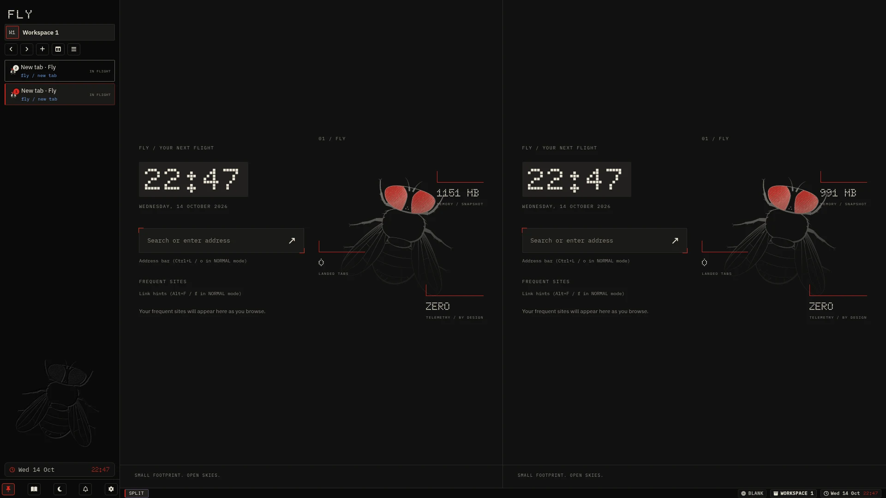

# Mise Browser

> An efficient, keyboard-first, and container-isolated web browser engineered specifically for low-resource and fanless Linux hardware.

[](https://github.com/Rakosn1cek/Mise-browser/releases/latest)
[](https://rakosn1cek.github.io/Mise-browser/)
[](LICENSE)

Named after the Czech word for *"mission"*, Mise leverages the Chromium rendering engine wrapped inside a streamlined Electron framework to minimise system overhead while delivering a fast, isolated web experience without mouse dependency.

📖 **Official Documentation**: [https://rakosn1cek.github.io/Mise-browser/](https://rakosn1cek.github.io/Mise-browser/)  
📦 **Download Packages (v0.15.0)**: [GitHub Releases](https://github.com/Rakosn1cek/Mise-browser/releases/latest) • [Direct Package Links](#downloads)



***

## Key Highlights

* **True Tab Hibernation**: Detaches idle `<webview>` tags completely from the DOM across all workspaces, terminating idle Chromium renderer processes and reducing RAM usage by 60% or more. Live URLs, page titles, and scroll offsets are restored on demand.
* **Auto-Collapsing Vertical Strip**: The vertical sidebar collapses into a 36px icon strip displaying workspace badges and tab favicons, expanding smoothly as an overlay on hover or via shortcut without triggering webview layout shifts.
* **Multi-Account Container Partitions**: Each workspace runs in its own isolated Electron persistent partition (`persist:work`, `persist:personal`), preventing cookie cross-contamination across accounts.
* **Mouse-Free Navigation**: Complete keyboard control via Link Hints, floating address bar with search aliases, and customisable shortcuts in `keybinds.json`.
* **Clipboard-Mediated Terminal Oversight**: High-risk script execution and raw web commands trigger a clipboard-mediated security handshake, sanitising and staging vetted commands to your clipboard for deliberate user review and execution in an external terminal.
* **Native Privacy & Trusted Sites**: Built-in request interception blocks trackers, telemetry, and advertisements without heavy third-party extensions, while allowing selective whitelisting for trusted banking and shopping services.
* **Local User Scripts & Styles**: Direct native injection of `.user.js` and `.user.css` files directly from `~/.config/mise-browser/` with inotify watching and live CSS hot-reloading, avoiding the heavy memory overhead of full WebExtensions.
* **Power Tools**: Integrated Markdown notes, bookmarks, quickmarks, actionable history overlay, and a full-page Command Centre.

***

## Security & Release Cadence

Security, isolation, and upstream dependency freshness are foundational principles for Mise:

* **Twice-Weekly Upstream Tracking**: Mise monitors upstream Electron and Chromium security releases twice weekly. Patches are evaluated, verified, and shipped promptly.
* **Engine Version Verification**: Active Mise, Electron, and Chromium runtime versions are visible directly within the Preferences overlay (`Ctrl + H`) and the Welcome view.
* **Strict Process Sandboxing**: Webviews run with `contextIsolation: true`, `nodeIntegration: false`, and Chromium sandboxing enabled, guarded by a minimal IPC whitelist.
* **Permissions Denied by Default**: Hardware access (camera, microphone, geolocation, and MIDI) is blocked by default.
* **Local Data Ownership & Zero Password Vault Targets**: Plaintext JSON configuration, notes, and history files are stored locally under user-only permissions (`0600`). Mise deliberately excludes built-in password managers, eliminating browser credential harvesting by infostealer malware. Session cookies are encrypted via host OS keyrings.
* **Responsible Disclosure**: See the [Security Policy](SECURITY.md) for vulnerability disclosure guidelines via GitHub Security Advisories.

***

## Downloads

Pre-built standalone binaries and packages are compiled and published for Linux, macOS, and Windows with each release.

> **Latest Release**: [**v0.15.0**](https://github.com/Rakosn1cek/Mise-browser/releases/latest) • [All Releases & Release Notes](https://github.com/Rakosn1cek/Mise-browser/releases)

| Platform | Format | Architecture | Direct Download | Notes |
| :--- | :--- | :--- | :--- | :--- |
| **Linux** | AppImage | x64 | [Mise.Browser-0.15.0.AppImage](https://github.com/Rakosn1cek/Mise-browser/releases/download/v0.15.0/Mise.Browser-0.15.0.AppImage) | Portable executable (`chmod +x` and run) |
| **Linux** | tar.gz | x64 | [mise-browser-0.15.0.tar.gz](https://github.com/Rakosn1cek/Mise-browser/releases/download/v0.15.0/mise-browser-0.15.0.tar.gz) | Standalone tarball archive |
| **macOS** | DMG | Apple Silicon (arm64) | [Mise.Browser-0.15.0-arm64.dmg](https://github.com/Rakosn1cek/Mise-browser/releases/download/v0.15.0/Mise.Browser-0.15.0-arm64.dmg) | Drag and drop installer |
| **macOS** | ZIP | Apple Silicon (arm64) | [Mise.Browser-0.15.0-arm64-mac.zip](https://github.com/Rakosn1cek/Mise-browser/releases/download/v0.15.0/Mise.Browser-0.15.0-arm64-mac.zip) | Standalone application bundle |
| **Windows** | Setup EXE | x64 | [Mise.Browser.Setup.0.15.0.exe](https://github.com/Rakosn1cek/Mise-browser/releases/download/v0.15.0/Mise.Browser.Setup.0.15.0.exe) | NSIS desktop installer |
| **Windows** | Portable EXE | x64 | [Mise.Browser.0.15.0.exe](https://github.com/Rakosn1cek/Mise-browser/releases/download/v0.15.0/Mise.Browser.0.15.0.exe) | Portable binary without installation |
| **Integrity** | Checksums | All | [SHA256SUMS.txt](https://github.com/Rakosn1cek/Mise-browser/releases/download/v0.15.0/SHA256SUMS.txt) | Cryptographic SHA-256 hash list |

### Quick Run (Linux AppImage)

```bash
chmod +x Mise.Browser-0.15.0.AppImage
./Mise.Browser-0.15.0.AppImage
```

No `libfuse2` is needed. On systems without FUSE, run it with `--appimage-extract-and-run`.

### Verifying Package Integrity

Download `SHA256SUMS.txt` into the same folder as your downloaded package and run:

```bash
sha256sum -c SHA256SUMS.txt
```

For full installation guides and platform configurations, visit the [Installation Guide](https://rakosn1cek.github.io/Mise-browser/guide/installation).

***

## Quick Start (Running from Source)

For developers and contributors running Mise directly from the repository:

### Prerequisites
* Linux (recommended), macOS, or Windows
* `Node.js` (v20+ recommended) and `npm`
* A terminal emulator (e.g. Kitty, Alacritty, Foot, st, xterm)

### Clone & Launch

```bash
# Clone the repository
git clone git@github.com:Rakosn1cek/Mise-browser.git
cd Mise-browser

# Install dependencies
npm install

# Start the browser
npm start
```

On Linux systems, you can also launch directly using the helper script:
```bash
./launch.sh
```

***

## Documentation

Comprehensive user guides and configuration references are hosted on the GitHub Pages site:

* [Getting Started & Philosophy](https://rakosn1cek.github.io/Mise-browser/guide/getting-started)
* [Mouse-Free Navigation & Link Hints](https://rakosn1cek.github.io/Mise-browser/guide/navigation)
* [Workspaces & Multi-Account Containers](https://rakosn1cek.github.io/Mise-browser/guide/workspaces-and-containers)
* [True Tab Hibernation Guide](https://rakosn1cek.github.io/Mise-browser/guide/tab-hibernation)
* [Local User Scripts & Styles Guide](https://rakosn1cek.github.io/Mise-browser/guide/user-scripts-and-styles)
* [Terminal Security & Oversight Scanner](https://rakosn1cek.github.io/Mise-browser/guide/terminal-oversight)
* [Keyboard Shortcuts Reference](https://rakosn1cek.github.io/Mise-browser/reference/keybinds)
* [Configuration Files Reference](https://rakosn1cek.github.io/Mise-browser/reference/configuration)

***

## Standalone Oversight Security Tool (Optional)

Mise never executes shell commands directly or automatically in the background. When terminal operations are triggered, commands are copied to the system clipboard and an empty, unmanaged terminal emulator is spawned.

Active command and script scanning is handled exclusively by [Oversight](https://github.com/Rakosn1cek/oversight), an independent external Rust-based terminal security intelligence scanner and interactive pager:

* **With Oversight Installed**: High-risk scripts and commands are audited for malicious patterns, Shannon entropy obfuscation, and CVE vulnerabilities prior to execution.
* **Without Oversight (Default)**: Oversight is completely optional and unbundled. Without it, commands copied to your clipboard are pasted and run entirely at your own risk without automated checks.

***

## Project Policies

* [Privacy Policy](PRIVACY.md) (Zero telemetry, container isolation, and local data ownership)
* [Security Policy](SECURITY.md) (Process sandboxing, threat model, and responsible disclosure)
* [AI Policy](AI_POLICY.md) (Human architecture governance and zero runtime AI integration)

***

## Community & Discussion

* [Reddit (r/mise_browser)](https://www.reddit.com/r/mise_browser/)
* [Mastodon (@misebrowser@mastodon.social)](https://mastodon.social/@misebrowser)
* [GitHub Discussions](https://github.com/Rakosn1cek/Mise-browser/discussions)

***

## Licence

This project is licensed under the terms of the GNU General Public Licence v3.0 (or any later version). See the [LICENSE](LICENSE) file for details.
