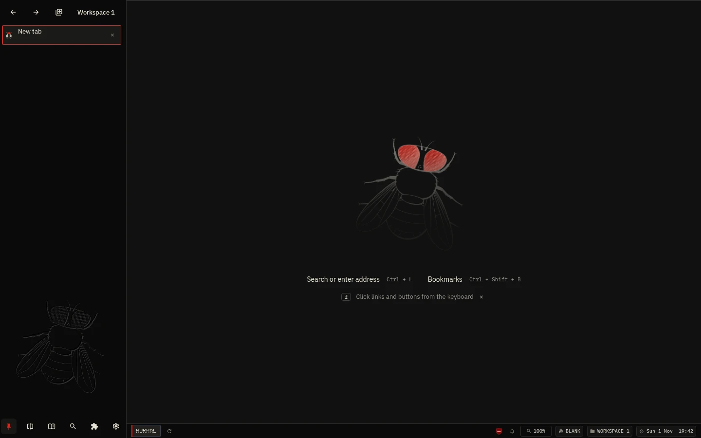

# Fly Browser

Fly is a Linux browser built on the full Chromium browser layer with native
Views UI: a compact vertical sidebar, keyboard navigation, split view and
workspaces with separate Chromium profiles.

[Documentation](docs/guide/getting-started.md) ·
[Releases](https://github.com/Arzuparreta/fly-browser/releases) ·
[Contributing](CONTRIBUTING.md)



## Install

```sh
mkdir -p ~/.local/bin
curl -fsSL https://raw.githubusercontent.com/Arzuparreta/fly-browser/main/scripts/fly-install -o ~/.local/bin/fly-install
chmod +x ~/.local/bin/fly-install
~/.local/bin/fly-install install
```

`fly-install` installs native Chromium Fly for Linux x86_64, checks the release
SHA-256 and adds Fly to the applications menu. Use `fly-install update`,
`fly-install status` or `fly-install uninstall`. Arch users can use the generated
`fly-browser-bin` package. A release must contain the native tarball; the
installer fails clearly on older Electron-only releases.

See [installation](docs/guide/installation.md) for details.

Native release packaging currently supports Linux x86_64. macOS, Windows and
AppImage downloads from earlier releases belong to Electron legacy; native
packages for those platforms are not yet available.

## Features

- Keyboard commands, link hints, floating address bar and editable shortcuts.
- Isolated workspace profiles, native split view and private browsing.
- Bookmarks, shared history, frequent sites and state-preserving tab suspension.
- Chrome Web Store extensions and bundled uBlock Origin Lite.
- Local user scripts and styles through a generated component extension.
- Local data, no Fly telemetry, update notifications and native package updates.

## Development

`./launch.sh` (or `npm start`) starts Fly with a separate development profile on
any Linux x64 computer. Without a local engine build it downloads the published
release; `./launch.sh --pr 153` downloads the test build of pull request #153
([test builds](docs/releasing.md#test-builds-of-pull-requests)). Downloads are
checked against their SHA-256 and kept in `~/.cache/fly-browser-launch`.

To run your own changes, build the pinned engine and overlay using
[Chromium development](docs/chromium/build.md). The launcher then starts that
build:

```sh
FLY_ENGINE_ROOT=/path/to/fly-chromium npm start
```

`npm ci` installs tooling;
it does not download or build Chromium. `npm test` checks product contracts and
legacy regressions; native tooling and browser tests are separate explicit
commands. See [releasing](docs/releasing.md) for native build hosts and packaging.

Electron remains available with `npm run start:legacy` and
`npm run dist:legacy`; its source and comparison instructions are in
[Electron legacy](legacy/electron/README.md).

## Project

Fly is the renamed, independent continuation of Mise. It does not track or
contribute to its former upstream. Original copyright notices are retained.
Licensed under [GPL-3.0-or-later](LICENSE).

[Security](SECURITY.md) · [Privacy](PRIVACY.md) ·
[Implementation evidence and limitations](docs/chromium/implementation-status.md)
